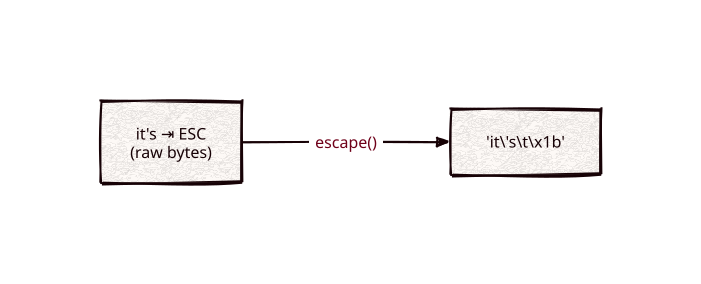

# escape

Part of [Kronuz C++ Libraries](https://github.com/Kronuz/cpp-libraries), a collection of small, reusable C++ libraries.

[](https://github.com/Kronuz/escape/actions/workflows/ci.yml)
[](LICENSE)


Escape a byte buffer the way a C string literal would, in C++20: `\n`, `\t`,
`\\`, the quote, and `\xNN` for everything else unprintable, so untrusted or
binary data is safe to print and log.



## ✨ Highlights

- **C-literal escapes**: `\n`, `\r`, `\t`, `\\`, the active quote, and lowercase
  `\xNN`.
- **Size-based**, so embedded NULs are shown.
- **Quotes your way**: single, double, or none.

## 📦 Installation

Requires a C++20 compiler and CMake 3.14 or newer; it compiles one source file.
CI builds it on Linux (x86_64, arm64), macOS (arm64, x86_64), and FreeBSD, plus
ASan, UBSan, and TSan builds.

```cmake
include(FetchContent)
FetchContent_Declare(escape
  GIT_REPOSITORY https://github.com/Kronuz/escape.git
  GIT_TAG        main)
FetchContent_MakeAvailable(escape)

target_link_libraries(my_app PRIVATE escape::escape)
```

## 🚀 Quick start

```cpp
#include "escape.hh"

#include <cstdio>
#include <string>

int main() {
	std::puts(escape(std::string("it's\t\x1b")).c_str());   // 'it\'s\t\x1b'
	std::puts(escape(std::string("hello"), '\0').c_str());  // hello
}
```

## 🎯 When to use it

- ✅ Showing untrusted bytes in error messages and logs.
- ⚠️ [repr](https://github.com/Kronuz/repr) does the same and more (truncation,
  an all-hex mode); prefer it for new code.

## ⚡ Performance

`escape` sizes its result exactly (a table gives each byte's output length), then
copies runs of plain printable bytes eight at a time and escapes the rest byte by
byte. On Apple silicon (Apple clang 17, -O3), against the previous implementation: printable text
3.8-6x faster (4 KB: 5.5 us to 0.91 us; `absl::CEscape`, which writes a different format, takes
2.3 us), 10% non-printable 3.5x, all-binary 1.45x.
Run it with `cmake -B build -DESCAPE_BUILD_BENCH=ON && cmake --build build && ./build/escape_bench`;
`ctest` also runs a differential test against the previous implementation.

## 📚 Documentation

- [docs/API.md](docs/API.md): the overloads and the quoting rules.
- [ARCHITECTURE.md](ARCHITECTURE.md): the escaping table.
- [AGENTS.md](AGENTS.md): repository map and traps.

## 🛠️ Building and testing

```sh
cmake -B build && cmake --build build && ctest --test-dir build
```

## 🤝 Contributing

Issues and pull requests are welcome. Read [AGENTS.md](AGENTS.md) first. CI must
pass on every platform.

## 📄 License

MIT, Copyright (c) 2015-2019 Dubalu LLC. See [LICENSE](LICENSE). Extracted from
[Xapiand](https://github.com/Kronuz/Xapiand).
