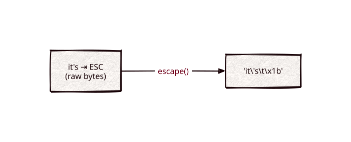

# escape

Part of [Kronuz C++ Libraries](https://github.com/Kronuz/cpp-libraries), a collection of small, reusable C++ libraries.

[](https://github.com/Kronuz/escape/actions/workflows/ci.yml)
[](LICENSE)


Escape a byte buffer the way a C string literal would, in C++20: `\n`, `\t`,
`\\`, the quote, and `\xNN` for everything else unprintable, so untrusted or
binary data is safe to print and log.



## ✨ Highlights

- **C-literal escapes**: `\n`, `\r`, `\t`, `\\`, the active quote, and lowercase
  `\xNN`.
- **Size-based**, so embedded NULs are shown.
- **Quotes your way**: single, double, or none.

## 📦 Installation

Requires a C++20 compiler and CMake 3.14 or newer; it compiles one source file.
CI builds it on Linux (x86_64, arm64), macOS (arm64, x86_64), and FreeBSD, plus
ASan, UBSan, and TSan builds.

```cmake
include(FetchContent)
FetchContent_Declare(escape
  GIT_REPOSITORY https://github.com/Kronuz/escape.git
  GIT_TAG        main)
FetchContent_MakeAvailable(escape)

target_link_libraries(my_app PRIVATE escape::escape)
```

## 🚀 Quick start

```cpp
#include "escape.hh"

#include <cstdio>
#include <string>

int main() {
	std::puts(escape(std::string("it's\t\x1b")).c_str());   // 'it\'s\t\x1b'
	std::puts(escape(std::string("hello"), '\0').c_str());  // hello
}
```

## 🎯 When to use it

- ✅ Showing untrusted bytes in error messages and logs.
- ⚠️ [repr](https://github.com/Kronuz/repr) does the same and more (truncation,
  an all-hex mode); prefer it for new code.

## ⚡ Performance

`escape` sizes its result exactly (a table gives each byte's output length), then
tests the input a block at a time (16 bytes with NEON or SSE2, 8 with a portable
fallback): a clean block is copied whole and the escapes of any other block are
written from the table. The kernel is [char-classify](https://github.com/Kronuz/char-classify)'s
`chars_escape.hh`, shared with `repr`. `absl::CEscape` writes a different format, so
the benchmark uses it as a speed reference only.

```sh
cmake -B build -DESCAPE_BUILD_BENCH=ON && cmake --build build && ./build/escape_bench
```

Time per call, `-O3`, Apple clang 17, on an Apple M4 Pro and an Intel i9-9980HK
(minimum over interleaved samples; `escape_bench` prints the same rows):

| input | M4 Pro: `escape` / `absl::CEscape` | i9-9980HK: `escape` / `absl::CEscape` |
|---|---:|---:|
| printable 16 B | 8 ns / 10 ns | 21 ns / 16 ns |
| printable 256 B | 47 ns / 183 ns | 159 ns / 382 ns |
| printable 4 KB | 422 ns / 2.2 us | 890 ns / 4.1 us |
| printable 64 KB | 7.0 us / 35.5 us | 23.0 us / 64.9 us |
| mixed 10% 64 KB | 13.2 us / 35.4 us | 38.8 us / 62.7 us |
| 10% control bytes, 4 KB | 839 ns / 2.2 us | 1.7 us / 3.9 us |
| binary 4 KB | 1.7 us / 2.3 us | 3.1 us / 4.0 us |

`absl::CEscape` is faster for inputs of a few bytes (up to 8 on the M4 Pro, up to
about 40 on the i9). From 256 bytes up, `escape` is ahead on every row measured.

Against the frozen original (`test/escape_old.cc`, which `escape_bench` samples in turn with `escape`;
three runs agree), inputs of 1 to 4 printable bytes are level on the M4 Pro (0.98x to 1.10x) and take 2 to 3 ns
longer on the i9 (1 B: 15.6 to 17.7 ns, 4 B: 21 to 23 ns), 11% to 16% more, the fixed work of the
kernel. From 7 bytes up `escape` is 2.5x to 3.7x faster up to 16 bytes on both machines. Sixteen bytes that all
need an escape under the double quote are 1.1x to 1.25x faster, and 4 KB of them 3.0x to 3.4x.

`ctest` checks the output byte for byte against a frozen copy of the previous
implementation, in the vector and the portable (`CHARS_NO_SIMD`) build.
[CHANGELOG.md](CHANGELOG.md) has the speedups over it.

## 📚 Documentation

- [docs/API.md](docs/API.md): the overloads and the quoting rules.
- [ARCHITECTURE.md](ARCHITECTURE.md): the escaping table.
- [AGENTS.md](AGENTS.md): repository map and traps.
- [CHANGELOG.md](CHANGELOG.md): what changed, and when.

## 🛠️ Building and testing

```sh
cmake -B build && cmake --build build && ctest --test-dir build
```

## 🤝 Contributing

Issues and pull requests are welcome. Read [AGENTS.md](AGENTS.md) first. CI must
pass on every platform.

## 📄 License

MIT, Copyright (c) 2015-2019 Dubalu LLC. See [LICENSE](LICENSE). Extracted from
[Xapiand](https://github.com/Kronuz/Xapiand).
